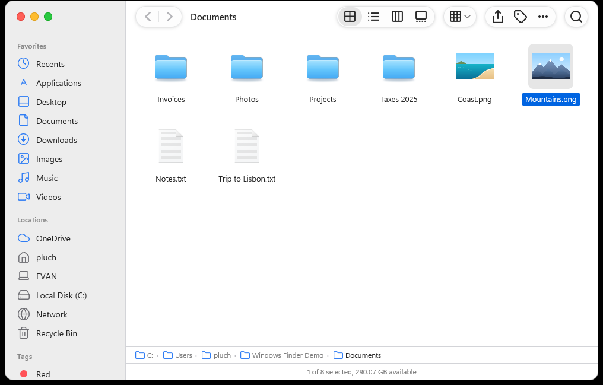

<div align="center">

# Windows Finder

**The macOS Finder, rebuilt for Windows.** A fast, native-feeling file manager written in Rust — icon, list, column and gallery views, tabs, Quick Look, tags, Get Info and a command palette, with the look and behaviour you know from a Mac.

[](LICENSE)




</div>

> *Windows Finder* is an independent open-source project. It is not affiliated with or endorsed by Apple Inc. “Finder” and “macOS” are trademarks of Apple Inc., used here only to describe what the app resembles.

## Why

Windows File Explorer is capable, but if you live on a Mac (or just prefer the Finder's calm, consistent design) it feels foreign. **Windows Finder is a macOS-style Finder for Windows**: the same window anatomy, the same four views, the same keyboard-friendly workflow — running on real Windows files, drives, OneDrive, WSL and the Recycle Bin.

## Features

**Views** — Icons (free placement and snap-to-grid), List (expandable folders), Columns (with preview column) and Gallery (large preview + thumbnail strip). Per-folder options (icon size, grid spacing, sort, group by, columns), remembered between launches.

**Navigation** — Tabs (reopen closed tab, tab overview), sidebar with Favorites / Locations / Tags, pinnable folders, path bar, *Go to Folder* (`Ctrl+Shift+G`), *Connect to Server* (`Ctrl+K`), spring-loaded folders, back/forward including mouse buttons.

**Look & feel** — Traffic-light buttons, unified toolbar, translucent-style panels, rounded window, light **and** dark mode that follow Windows, accent colours, SF-style symbols.

**Files** — Copy / cut / paste with conflict resolution and a progress sheet, undo / redo, in-app Recycle Bin with *Put Back*, bulk rename, tags (colour labels), aliases (shortcuts), ZIP / 7z / RAR / TAR extraction, drag and drop in and out (to Explorer too).

**Look closer** — **Quick Look** (`Space`) for images, text, CSV, PDF and video (with playback controls); editable text and CSV right in the preview. **Get Info** (`Ctrl+I`) with sizes, dates, kind, permissions, *open with* and preview.

**Search** — Recursive search by name or file contents, with kind filters (images, documents, folders, audio / video).

**Windows integration** — *More Options…* shows the **real Explorer context menu** (Send to, Git, 7-Zip, Properties…), open in Windows Terminal, run as administrator, set as desktop picture, rotate images, WSL distributions in the sidebar, network page, optional **default file manager** and an *Open in Windows Finder* entry in Explorer's right-click menu (per-user registry only, fully reversible).

**Command palette** — `Ctrl+Shift+P` finds any command with its shortcut.

**Languages** — English, Français, Español, Deutsch; follows your Windows language by default (change it in Settings).

## Install

There are no binary releases yet. Build it (about two minutes):

```powershell
# Requirements: Windows 10/11, Rust stable, Visual Studio Build Tools (C++ workload)
git clone https://github.com/EvanPluchart/windows-finder.git
cd windows-finder
cargo build --release
.\target\release\WindowsFinder.exe
```

Settings, tags and per-folder options live in `%APPDATA%\winfinder`.

## Keyboard shortcuts (Windows equivalents of the Finder's)

| Action | Keys |
|---|---|
| Views: icons / list / columns / gallery | `Ctrl+1` … `Ctrl+4` |
| Quick Look | `Space` |
| Get Info | `Ctrl+I` |
| Rename | `Enter` or `F2` |
| New folder / tab / window | `Ctrl+Shift+N` / `Ctrl+T` / `Ctrl+N` |
| Reopen closed tab | `Ctrl+Shift+T` |
| Go to Folder | `Ctrl+Shift+G` |
| Command palette | `Ctrl+Shift+P` |
| Copy path | `Ctrl+Shift+C` |
| Show hidden files | `Ctrl+Shift+.` |
| View options | `Ctrl+J` |
| Settings | `Ctrl+,` |

Full list: [`docs/shortcuts.md`](docs/shortcuts.md).

## How it was made

The design and behaviour come from a reverse-engineering study of the macOS Finder (window geometry, colours, view layouts, menus), then cross-checked against the native **Windows File Explorer** and the **Files** app to catch useful features the Finder lacks. The reports are in [`docs/`](docs/) and [`docs/research/`](docs/research/). The UI is built with [GPUI](https://crates.io/crates/gpui) (the GPU-accelerated UI framework behind Zed) and the `windows` crate for Win32 / WinRT.

## Roadmap

- [ ] Open icon set to replace the Apple-derived artwork (blocking a public release, see [`assets/NOTICE.md`](assets/NOTICE.md))
- [ ] Signed installer / winget / Scoop packages
- [ ] Column and gallery inspectors with more quick actions
- [ ] Dragging a tab out into a window
- [ ] Optional Git status in lists
- [ ] More languages (see *Contributing*)

## Contributing

Contributions are welcome — see [CONTRIBUTING.md](CONTRIBUTING.md). Adding a translation is a one-line change per string in `assets/i18n.txt`. Please follow the [Code of Conduct](CODE_OF_CONDUCT.md).

## License

[MIT](LICENSE) for the code. Bundled third-party artwork has its own terms: read [`assets/NOTICE.md`](assets/NOTICE.md).

---

### Français

**Windows Finder** est un gestionnaire de fichiers open source pour Windows qui reprend l'interface et le comportement du **Finder de macOS** : vues Icônes / Liste / Colonnes / Galerie, onglets, Aperçu rapide (`Espace`), étiquettes, « Lire les informations », palette de commandes, menu natif de Windows via « Plus d'options… ». Écrit en Rust, compatible Windows 10 et 11, interface en français, anglais, espagnol et allemand (langue de Windows par défaut). Licence MIT, contributions bienvenues.
